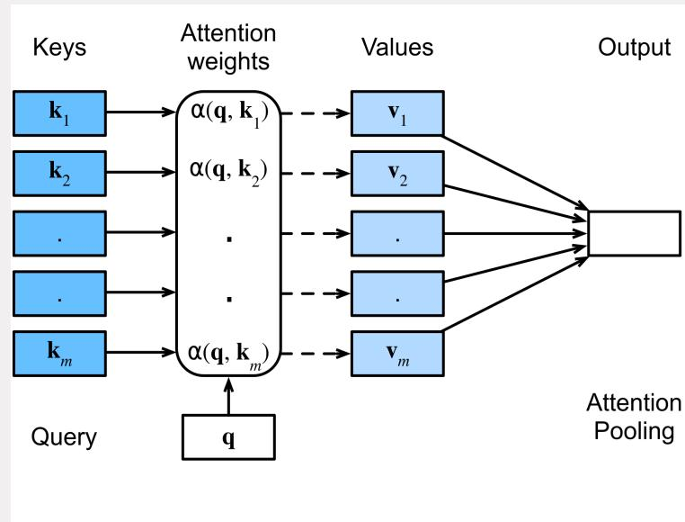
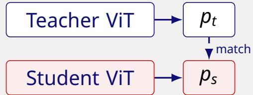
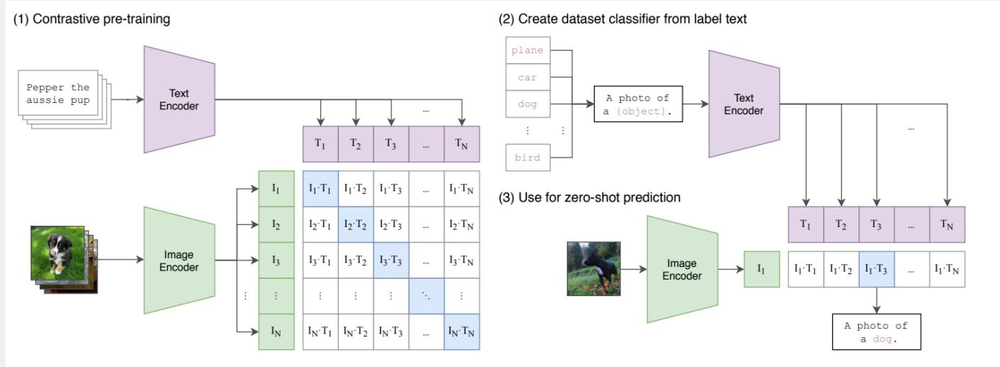
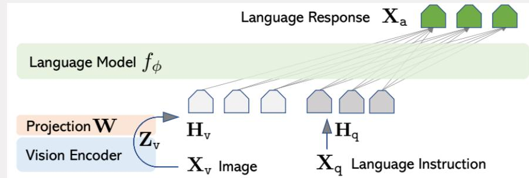
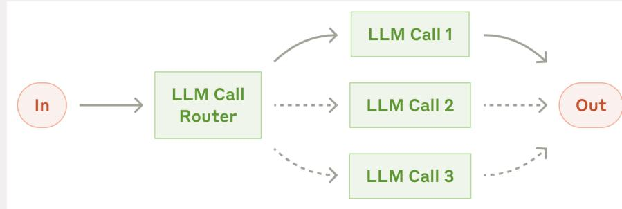
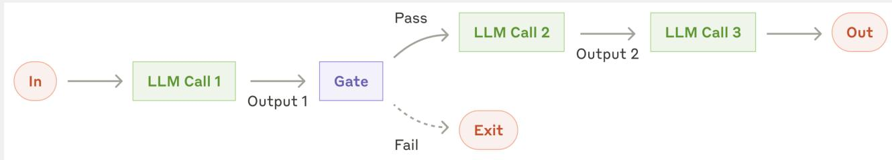
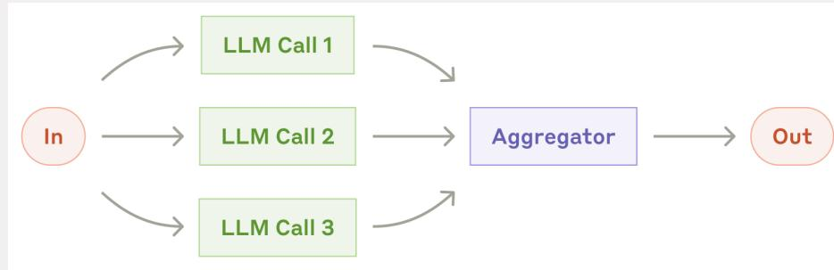
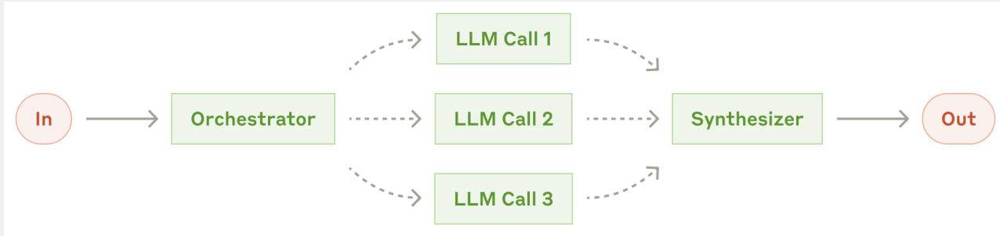
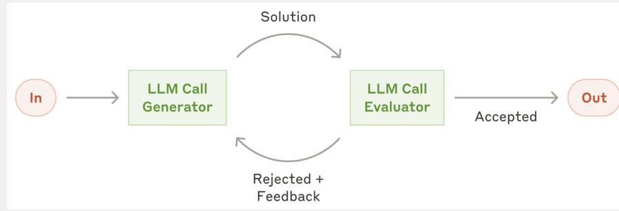
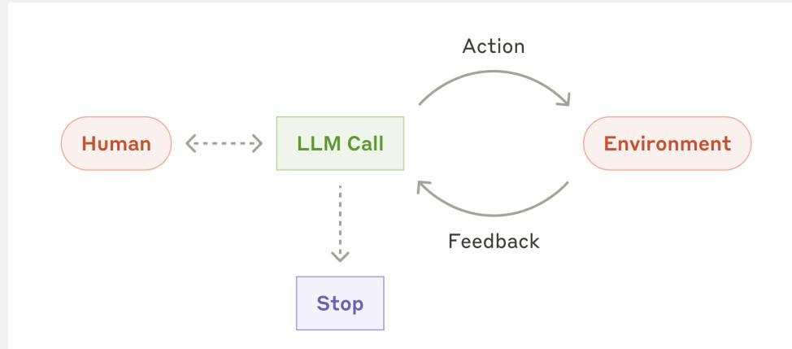

# Key figures · one line each

Visual recall10 figuresSay the mechanism

The diagrams that carry most of the exam vocabulary. For each one, the caption is what you should be able to say out loud in the exam — the picture is just the anchor.

## Attention: queries, keys, values

Self-attention: $q$ from one position is compared with all keys; the softmax weights mix the corresponding values. **Self** = Q, K, V from the same sequence; **cross** = Q from one sequence, K/V from another. Trainable projections, unlike the picture's fixed $v_i$.

## DINO: two views, one teacher

Two augmented views of the same image; the teacher (EMA of the student) produces targets, the student predicts them. The mismatch shown across positions is the **cross-view / patch-level** matching problem. Slow EMA teacher → stable targets, no collapse.

## CLIP: contrastive image–text

Maximise similarity of the $N$ matching pairs, minimise the $N^2-N$ mismatched pairs. Zero-shot classification = compare the image with text prompts; the softmax is **over the candidate set**, not a calibrated disease probability.

## How an image enters a language model

Matching the **length** of the vector is not enough: the projection $W$ and alignment/instruction tuning are what make the LM able to read the visual tokens. Without training, the CLIP vector is out of distribution.

## Workflow pattern: routing

One path is selected. Contrast with **parallelization**, where all paths run and an aggregator combines them. This is the most common MCQ trap.

## Workflow pattern: prompt chaining

Fixed stages, each consuming the previous output; a gate decides whether to continue. Extract → draft → translate is chaining, not routing.

## Workflow pattern: parallelization

Subtasks are defined in advance and independent; results are aggregated. Use when the decomposition is known before execution.

## Workflow pattern: orchestrator–workers

The orchestrator decides **at runtime** which subtasks are needed. Extra coordination cost: more calls/latency, error propagation, non-determinism, harder evaluation — justify it only when the paths depend on the case.

## Workflow pattern: evaluator–optimizer

Generator drafts, evaluator checks against criteria and either accepts or returns feedback. Acceptance must be distinguishable from "revision limit reached"; validate the evaluator itself against human ratings.

## The agent loop

Reason → act → observe → repeat until a stop condition. The environment executes tools; observations come from the tool, not from the model's prediction. Use an agent only when the next step depends on observations.
