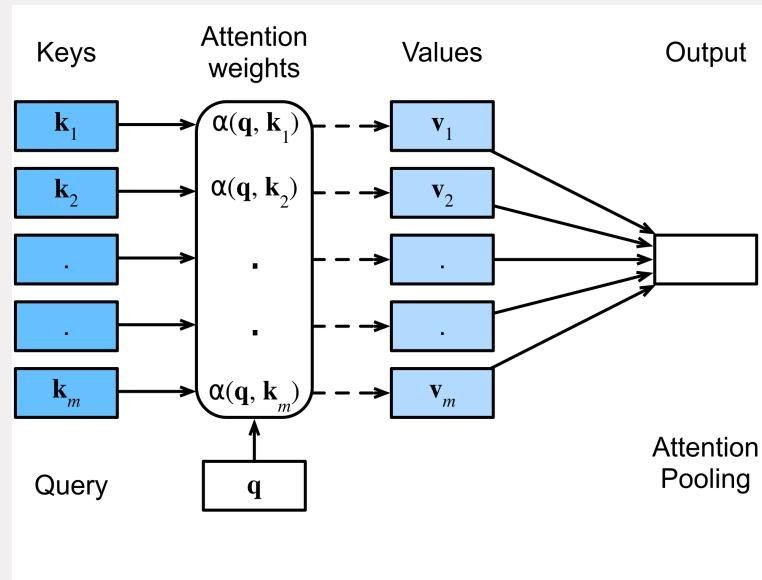
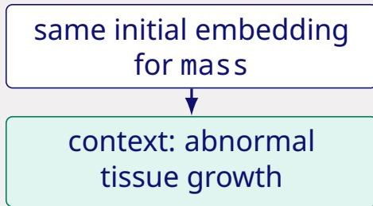
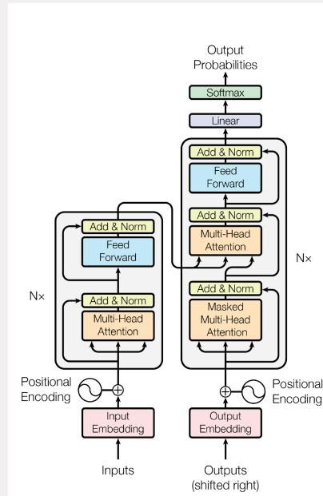

# 1 · Language models

Lecture 1~15 minRead → answer → check

Each idea is explained in plain words and ends with a question. Answer it out loud before opening the answer — that is the exam skill.

## 1. Text becomes tokens

**Explanation.** A model cannot read letters, so text is cut into **tokens**: common words stay whole, rare words are split into pieces ("unhappiness" → "un" + "happi" + "ness"). Every token in the **vocabulary** (the fixed list of tokens the model knows) has an ID, and each ID is mapped to a learned vector called an **embedding** — a list of numbers that represents the token's meaning.

**Why pieces.** A fixed vocabulary cannot contain every word, especially in medicine ("pneumonoultramicroscopic..."), so splitting lets the model build rare words from known parts.

!!! question "Check yourself"
    Why does a model use word pieces instead of whole words, and what does the embedding of a token contain?

??? success "Answer"
    Whole words would need an enormous vocabulary and would still miss new or rare terms; pieces let rare words be composed from known parts. The embedding is a learned vector of numbers representing that token, learned during training — not a dictionary definition.

## 2. Positions tell the model where a token sits

**Explanation.** Attention (next section) looks at all tokens at once and does not know their order. So a **position vector** $p_i$ — a second learned vector that depends only on the index $i$ — is added to each token embedding: $h_i^{(0)} = e(x_i) + p_i$. Without it, "dog bites man" and "man bites dog" look identical.

**Term.** *Permutation-invariant* means the result does not change if you reorder the inputs.

!!! question "Check yourself"
    Two radiology reports contain the same words in different order: "left opacity, right clear" and "left clear, right opacity". A model adds no position information. Can it tell them apart, and why?

??? success "Answer"
    No. Without positions the model sees the same **set** of token vectors for both reports; attention is permutation-invariant, so it produces the same representation. Order must be encoded before anything mixes the tokens.

## 3. Self-attention mixes tokens

**Explanation.** Each token creates three vectors: a **query** $q$ ("what am I looking for?"), a **key** $k$ ("what do I contain?") and a **value** $v$ ("what do I pass on?"). The model compares each query with all keys (dot product), turns the scores into weights with **softmax** (a function that makes a list of scores sum to 1), and uses the weights to average the values. That average is the token's new, context-aware representation. Written as a matrix: $\mathrm{softmax}(QK^\top/\sqrt{d_k})V$, where $\sqrt{d_k}$ keeps the scores from growing too large. **Multi-head attention** runs several of these in parallel so different heads can track different relationships.

**Self vs cross.** In **self-attention**, Q, K and V all come from the same sequence. In **cross-attention**, Q comes from one sequence (e.g. the decoder) and K/V from another (e.g. the encoder).

{ width="430" }

*Attention is a weighted average: the query decides which values matter. In a Transformer the keys and values are learned projections, not the raw vectors shown here.*

{ width="470" }

*Same token, same initial embedding — but "mass" attends to different context words in "abnormal tissue growth" and "amount of matter". That is what makes the final representation context-dependent.*

!!! question "Check yourself"
    In a Transformer encoder–decoder translation model, which attention uses queries from the German sentence and keys/values from the English one?

??? success "Answer"
    Cross-attention: the decoder (generating English) supplies the queries; the encoder representation of the source supplies keys and values. Self-attention would take all three from the same sequence.

## 4. The causal mask stops the model seeing the future

**Explanation.** During **autoregressive** training (predict the next token), the model must not look at the token it is supposed to predict. A **causal mask** sets the attention weights to zero for all future positions, so position $i$ can only attend to positions $\le i$. Remove it and the model trivially copies the answer — **leakage**.

{ width="330" }

*Read the two blocks: the encoder tries to understand, the decoder generates with a mask. The skip connections carry the original signal past each sub-layer.*

!!! question "Check yourself"
    A decoder has two attention layers. Only layer 2 has a causal mask; layer 1 is full attention. Can the representation at "is" already contain information from a later word "absent"?

??? success "Answer"
    Yes. Layer 1 attended to every position, including "absent", so its output at "is" already contains that information. The mask in layer 2 only restricts attention *inside* layer 2. The mask must be causal at **every** layer, otherwise the model can leak the target.

## 5. Training is next-token prediction

**Explanation.** For each position the model predicts a probability distribution over the vocabulary, and the **loss** (cross-entropy) measures how much probability it gave to the actual next token. The text supplies its own labels, so pretraining needs no annotators.

**Teacher forcing** means training with the *real* previous tokens as input. At generation time the model instead sees its **own** previous outputs, so one early mistake changes everything after it — **exposure bias**. **Greedy decoding** always picks the single most probable next token.

!!! question "Check yourself"
    Model A has lower average next-token loss than B, yet writes "normal" when the report says "pending" more often. What does the lower loss actually establish, and does greedy decoding fix it?

??? success "Answer"
    Loss is an average over all tokens, and most tokens are common boilerplate; rare critical words barely move it. Lower loss only means A assigns slightly higher likelihood to observed text on average under teacher forcing — not that it is factually reliable. Greedy decoding does not fix it and can worsen it: the most probable continuation is often the frequent phrase ("was normal"), and greedy removes any chance of choosing the rarer correct word.

## 6. Prompting: zero-shot, few-shot, instruction tuning

**Explanation.** **Zero-shot** gives the model a task with no examples. **Few-shot** puts a few example input–output pairs in the prompt. **Instruction tuning** is a training stage on instruction–answer pairs so the model follows requests. In prompting, the weights never change.

!!! question "Check yourself"
    A clinician pastes three example discharge letters before asking for a new one. Is this zero-shot, few-shot, or fine-tuning?

??? success "Answer"
    Few-shot prompting: examples in the context, weights frozen. Fine-tuning would update the model's parameters; zero-shot would give no examples.

## 7. RAG: give the model documents

**Explanation.** **Retrieval-augmented generation** searches an indexed collection of documents, puts the relevant passages into the prompt, and asks the model to answer using them. The index can be rebuilt whenever documents change; the model's weights stay frozen. It is the standard answer for knowledge that changes and must be cited.

!!! question "Check yourself"
    Clinical guidelines change several times a year and answers must cite the version. Should you fine-tune or use RAG, and how can the system still fail?

??? success "Answer"
    Use RAG with a versioned index and require citations (or abstain). Fine-tuning freezes a snapshot, cannot cite a version, and underrepresents rare cases. It can still fail if retrieval returns an outdated or wrong section, if retrieved passages conflict, or if the patient data used for retrieval is incomplete.

## 8. LoRA: cheap adaptation

**Explanation.** **LoRA** freezes the original weight matrix $W$ and learns a small low-rank update $\Delta W = BA$, where $B$ is $d \times r$, $A$ is $r \times k$, and the **rank** $r$ is tiny compared with $d$ and $k$. Only $A$ and $B$ are trained, so one base model can serve many tasks by swapping adapters. **Quantization** stores weights in fewer bits (e.g. 4-bit) to save memory; **QLoRA** = quantized base + LoRA.

!!! question "Check yourself"
    $W$ is $4096 \times 4096$ and $r = 8$. How many parameters does LoRA train, and why can one base model serve three departments?

??? success "Answer"
    $B$ is $4096 \times 8$ and $A$ is $8 \times 4096$, so $2 \times 32{,}768 = 65{,}536$ parameters instead of ~16.8 million — about 0.4%. The base weights stay frozen and shared; store one copy plus three small adapters and route each request to its department's adapter.

## 9. Evaluating facts, not averages

**Explanation.** A good evaluation defines the **unit** (letter, report, patient), the **outcome** (e.g. "letter contains a clinically significant factual error"), the **reference standard** (clinician review against the source record), and the **comparison** (paired, blinded, with confidence intervals).

!!! question "Check yourself"
    Design a comparison of two letter-writing models so that a difference in style cannot masquerade as a difference in safety.

??? success "Answer"
    Sample held-out reports **stratified** to include abnormal and pending results; show each clinician the source report and both letters in random order, blinded to the model; have them mark every claim as supported, contradicted or unsupported, with severity. Primary outcome: proportion of letters with at least one clinically significant error; compare paired per report (e.g. McNemar) and report confidence intervals and inter-rater agreement.

!!! tip "If you remember one thing"
    A lower loss means better **average text prediction**, not better **facts**. Say that and half of question 1 is answered.
